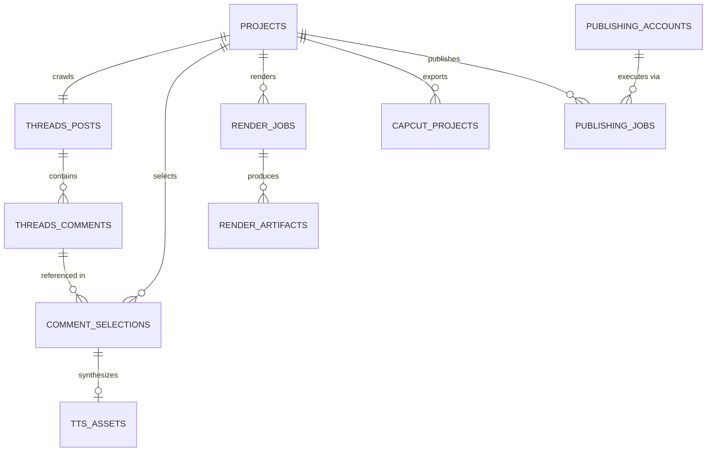

# Database Design — Threads Comment Video Studio

## 1. Relational Schema Architecture

The database is powered by SQLite (with WAL mode enabled) and mapped using SQLAlchemy 2.0 ORM. All primary keys are UUID strings or autoincrementing integers, and timestamps are stored in UTC ISO-8601 strings.

---

## 2. Table Definitions

### 2.1 `projects`
Stores high-level workspace metadata for a video creation session.
- `id` (VARCHAR(36), PK): UUID.
- `title` (VARCHAR(255), NOT NULL): Project title.
- `threads_url` (TEXT, NOT NULL): Target Threads URL.
- `status` (VARCHAR(50), NOT NULL): e.g., `draft`, `crawled`, `synthesized`, `rendered`, `exported`, `published`.
- `created_at` (DATETIME, NOT NULL): UTC creation timestamp.
- `updated_at` (DATETIME, NOT NULL): UTC last updated timestamp.
- `settings` (JSON): Project-specific configuration (font size, card theme, ducking volume, background video ID, etc.).

### 2.2 `threads_posts`
Original Threads post data crawled from the target URL.
- `id` (VARCHAR(64), PK): Threads post PK / ID.
- `project_id` (VARCHAR(36), FK -> projects.id, UNIQUE): One-to-one with project.
- `url` (TEXT, NOT NULL): Canonical Threads post URL.
- `author_username` (VARCHAR(128), NOT NULL): Post author handle.
- `author_display_name` (VARCHAR(255)): Post author full name.
- `author_avatar_url` (TEXT): Author profile image URL.
- `content` (TEXT, NOT NULL): Post text content.
- `media_urls` (JSON): Attached image or video URLs.
- `like_count` (INTEGER): Likes metric (NULL if not available).
- `reply_count` (INTEGER): Replies metric (NULL if not available).
- `repost_count` (INTEGER): Reposts metric (NULL if not available).
- `published_at` (DATETIME): UTC timestamp of publication.
- `crawled_at` (DATETIME, NOT NULL): UTC timestamp when crawled.

### 2.3 `threads_comments`
Original hierarchical comments and replies.
- `id` (VARCHAR(64), PK): Threads comment PK / ID.
- `post_id` (VARCHAR(64), FK -> threads_posts.id): Parent root post.
- `parent_comment_id` (VARCHAR(64), FK -> threads_comments.id, NULLABLE): For nested replies.
- `author_username` (VARCHAR(128), NOT NULL): Comment author handle.
- `author_display_name` (VARCHAR(255)): Comment author full name.
- `author_avatar_url` (TEXT): Comment author avatar.
- `content` (TEXT, NOT NULL): Original comment text.
- `like_count` (INTEGER): Likes count (NULL if unavailable).
- `reply_count` (INTEGER): Replies count (NULL if unavailable).
- `nesting_depth` (INTEGER, DEFAULT 0): 0 for top-level comments, 1+ for replies.
- `published_at` (DATETIME): UTC timestamp.
- `crawled_at` (DATETIME, NOT NULL): UTC crawl timestamp.

### 2.4 `comment_selections`
User selection, order, and customized texts for video scenes.
- `id` (VARCHAR(36), PK): UUID.
- `project_id` (VARCHAR(36), FK -> projects.id): Associated project.
- `comment_id` (VARCHAR(64), FK -> threads_comments.id): Reference to crawled comment.
- `sequence_order` (INTEGER, NOT NULL): Display order index (0, 1, 2, ...).
- `display_text` (TEXT, NOT NULL): Text shown on the visual card in the video.
- `tts_text` (TEXT, NOT NULL): Text synthesized by the voice generator.
- `voice_id` (VARCHAR(100)): Per-comment voice override (optional).
- `voice_rate` (FLOAT, DEFAULT 1.0): Speech speed multiplier.
- `is_active` (BOOLEAN, DEFAULT TRUE): Whether included in render.
- `created_at` (DATETIME, NOT NULL): UTC timestamp.
- `updated_at` (DATETIME, NOT NULL): UTC timestamp.

### 2.5 `tts_assets`
Generated audio voiceover assets.
- `id` (VARCHAR(36), PK): UUID.
- `selection_id` (VARCHAR(36), FK -> comment_selections.id, UNIQUE): Associated comment selection.
- `provider` (VARCHAR(50), NOT NULL): `edge_tts`, `fpt_ai`, `google_tts`.
- `voice` (VARCHAR(100), NOT NULL): Voice identifier.
- `audio_path` (TEXT, NOT NULL): Relative path to audio file on local disk.
- `duration_ms` (INTEGER, NOT NULL): Audio duration in milliseconds.
- `file_size_bytes` (INTEGER, NOT NULL): Size on disk.
- `content_hash` (VARCHAR(64), NOT NULL): SHA256 hash for cache deduplication.
- `created_at` (DATETIME, NOT NULL): Generation timestamp.

### 2.6 `media_assets`
Local asset catalog (Minecraft gameplay videos, background music tracks, logos).
- `id` (VARCHAR(36), PK): UUID.
- `type` (VARCHAR(50), NOT NULL): `background_video`, `background_music`, `watermark`.
- `name` (VARCHAR(255), NOT NULL): Friendly display name.
- `file_path` (TEXT, NOT NULL): Absolute or relative file path.
- `duration_ms` (INTEGER): Duration if video/audio.
- `width` (INTEGER): Width if video/image.
- `height` (INTEGER): Height if video/image.
- `file_size_bytes` (INTEGER, NOT NULL): File size in bytes.
- `created_at` (DATETIME, NOT NULL): Creation timestamp.

### 2.7 `render_jobs` & `render_artifacts`
Background video rendering tasks and output files.
- `id` (VARCHAR(36), PK): UUID.
- `project_id` (VARCHAR(36), FK -> projects.id): Associated project.
- `status` (VARCHAR(50), NOT NULL): `pending`, `processing`, `completed`, `failed`.
- `progress` (INTEGER, DEFAULT 0): 0 to 100 percentage.
- `error_message` (TEXT): Failure diagnostics if failed.
- `started_at` (DATETIME): Start time.
- `completed_at` (DATETIME): Finish time.

Artifacts table links to output MP4, CapCut ZIP packages, and preview snapshots.

### 2.8 `publishing_accounts` & `publishing_jobs`
Social platform connections and publish history.
- `publishing_accounts`: Platform (`youtube`, `facebook`, `tiktok`), account/page name, credentials encrypted/secured, token expiration.
- `publishing_jobs`: Project ID, Platform, Status (`pending`, `publishing`, `success`, `failed`), published URL, platform post ID, error log.
